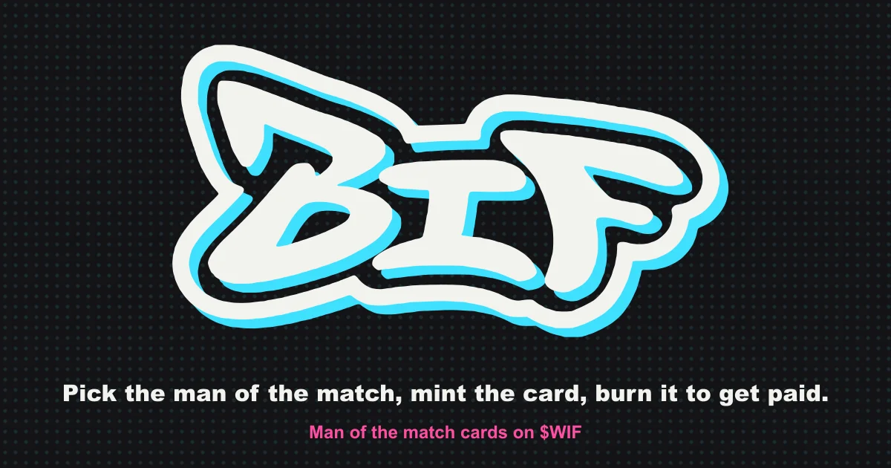
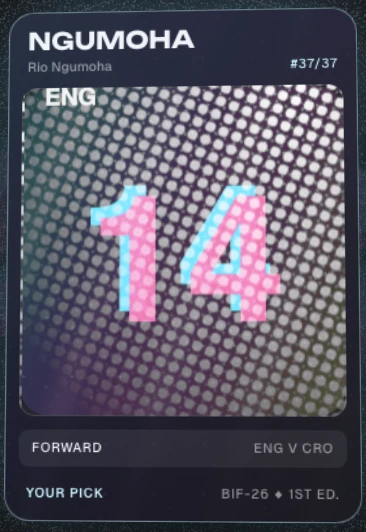
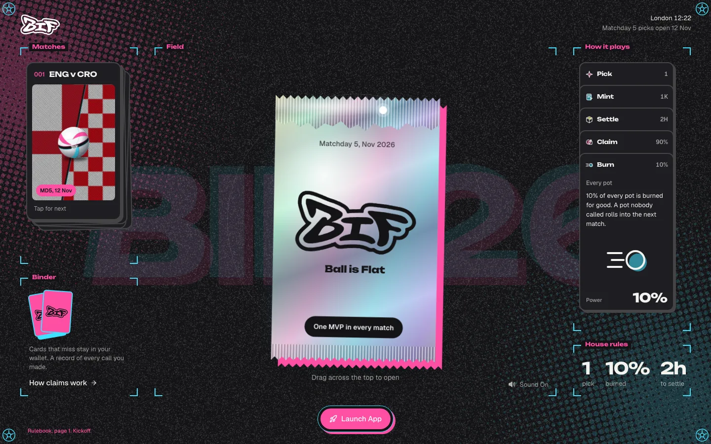
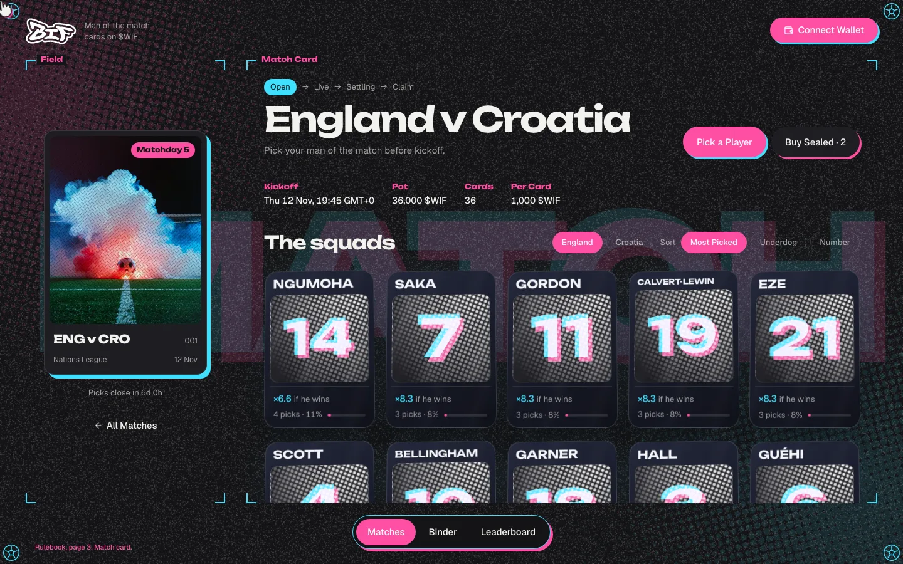
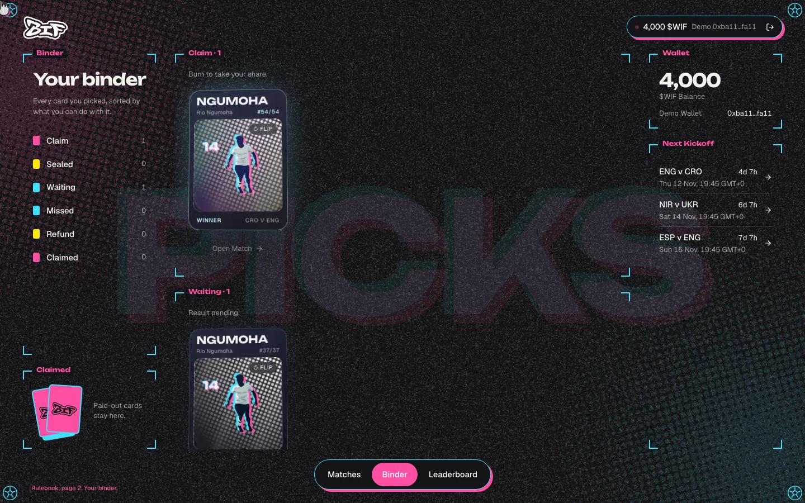
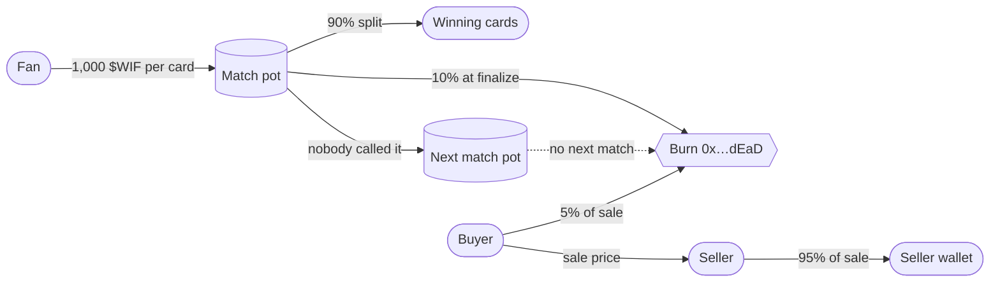
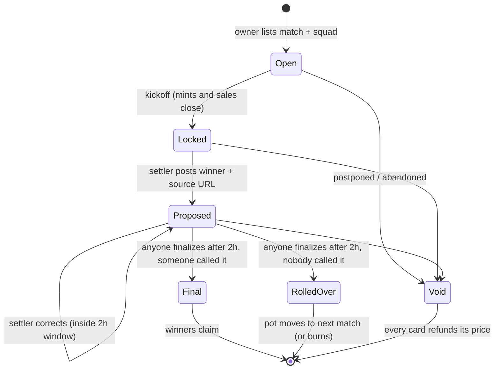
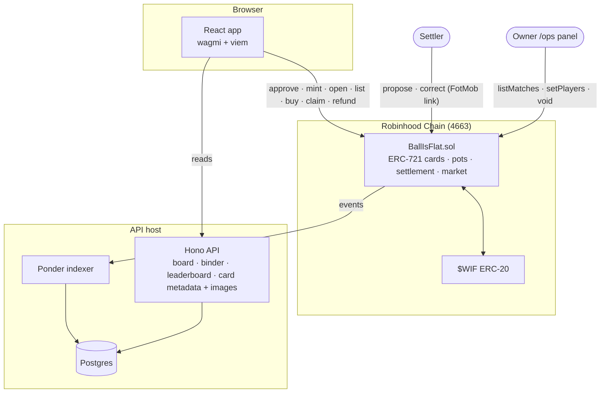

<div align="center">

<picture>
  <source media="(prefers-color-scheme: dark)" srcset="docs/media/logo-white.svg">
  
</picture>

# Ball is Flat

**Predicting the MVP in football is impossible. The ball is flat, everyone knows that.**

Pick the man of the match before kickoff, mint the pick as a card in $WIF,<br>
and burn the card to take your share of the pot when your player comes out on top.

[](packages/config/src/chain.ts)
[](https://dexscreener.com/robinhood/0x71ef4106340f0a3b9c19ec994eef4fc44a1d2513f38faac39d7636b156548c79)
[](packages/contracts/src/BallIsFlat.sol)
[](packages/contracts/test)
[](e2e)
[](https://worldisflat.fun/build)

[Landing](https://clever-overlay-569783.framer.app) · App (ballisflat.fun, going live before 12 Nov) · Demo video (soon) · [Architecture](docs/architecture.md) · [Security](docs/security.md)



</div>

---

## Contents

- [What is it](#what-is-it)
- [Sneak peek](#sneak-peek)
- [How it plays](#how-it-plays)
- [Where $WIF goes](#where-wif-goes)
- [Match lifecycle](#match-lifecycle)
- [Trust model](#trust-model)
- [Architecture](#architecture)
- [Tech stack](#tech-stack)
- [Getting started](#getting-started)
- [Scripts](#scripts)
- [Testing and evidence](#testing-and-evidence)
- [Deployments](#deployments)
- [Repo map](#repo-map)
- [Prior art](#prior-art)
- [FAQ](#faq)
- [Roadmap](#roadmap)
- [Team and AI use](#team-and-ai-use)

## What is it

Ball is Flat is a simple gameFi where you back the football player you think will run the match.

Before kickoff you pick **one player** and mint that pick as an **NFT card for 1,000 $WIF**. Every $WIF from every card goes into the match pot. After full time, the top-rated player (FotMob rating) is posted onchain with the source link, and there's a **2 hour window** to flag mistakes. If your player was the best on the pitch, you **burn your card and take your share** of the pot. The fewer people on your player, the bigger your share.

10% of every pot is burned. A pot nobody called rolls into the next match. Sealed cards can be resold before kickoff, and 5% of every sale is burned too.

Most products only care about scores and final results. Fans mostly talk about players: who was on fire, who played the dumbest, who deserves the applause. Ball is Flat turns that take into a card in your wallet, and pays you in $WIF when you're right.

## Sneak peek

<table>
  <tr>
    <td width="32%" align="center"><br><sub><b>The card.</b> One pick, one NFT, serial #37 of 37.</sub></td>
    <td width="68%" align="center"><br><sub><b>Landing.</b> The rulebook as a playmat, with a sealed pack to tear open.</sub></td>
  </tr>
</table>

<table>
  <tr>
    <td width="50%"><br><sub><b>The market.</b> Both squads, picks per player and "×N if he wins".</sub></td>
    <td width="50%"><br><sub><b>The binder.</b> Cards sorted by what you can do with them: claim, sell, wait, refund.</sub></td>
  </tr>
</table>

<sub>Screenshots come from the in-browser mock chain (`VITE_DATA_MODE=mock`) and are regenerated with `npx playwright test -c scripts/screenshots/screenshots.config.ts`.</sub>

## How it plays

| Step | What you do | What the contract does |
|---|---|---|
| **1. Pick** | Open a match, browse both squads, see what each player would pay right now | Nothing yet. "×N if he wins" is read from the live pot |
| **2. Mint** | Approve $WIF, mint one card for 1,000 $WIF | Takes the $WIF into the match pot, mints an ERC-721 card. One mint per wallet per match, at most 10 cards per player, closes at kickoff |
| **3. Open** | Tear the sealed pack | Marks the card opened. Opened cards can never be sold |
| **4. Sell (optional)** | List a sealed card, or buy one | Sale goes straight buyer to seller, 5% burned, only before kickoff |
| **5. Settle** | Watch the match | Settler posts the top-rated player plus the FotMob link. 2 hour dispute window, then anyone can finalize |
| **6. Claim** | Burn a winning card | Pays `pot × 90% ÷ winning cards` in $WIF. Losing cards stay in your wallet as a record |

Ties split the pot across every tied player's cards. A postponed or abandoned match is voided and every card refunds its full price.

## Where $WIF goes



- **$WIF is the only currency.** Card price, pot, payout, resale and burn are all $WIF on Robinhood Chain (`0x5173b8eA6923c2d40267890D45C46a3480954773`).
- **No team fee, no token of our own.** Pot money leaves only through a winning claim, a refund on a voided match, or the burn.
- **The flywheel.** Football has a match every few days, so the calendar brings people back. Every match burns $WIF, uncalled pots make the next match bigger, and a correct unpopular pick pays the most.

## Match lifecycle



`stateOf(matchId)` returns exactly these states, so the app and the API never guess.

## Trust model

| Power | Who | Limit |
|---|---|---|
| Move pot funds | Nobody directly | $WIF leaves only through `claim` (winning card burned), `refund` (voided match), the burn, or a rollover into the next match |
| Receive an uncalled pot | Nobody | It rolls into the next open match, or is burned when there is none |
| Move a card between wallets | Only `buy` | `transferFrom` / `safeTransferFrom` revert with `CardLocked`, so the sale burn always applies |
| List matches, set settler, pause new mints | Owner | Pausing stops mints only. Claims and refunds always work |
| Post and correct the result | Settler (one key, disclosed on the site) | Only players in the listed squad, only during the dispute window, always with a source URL |
| Void a match | Settler or owner | Only before finalize. Every card then refunds its full price |
| Finalize | Anyone | Only after the dispute window ends |
| Upgrade | Nobody | No proxy, no sweep |

The single settler is the open trust assumption for this event. The public source link, the dispute window and the void-with-full-refund path keep it honest. Multi-source and attested settlement are on the [roadmap](#roadmap).

Static analysis and reviewed findings: [`docs/security.md`](docs/security.md).

## Architecture



- **Squads as merkle roots.** Each match stores one root computed onchain from strictly ascending player ids, so listing 20 or 60 players costs the same. The same tree lives in [`packages/core/src/squad.ts`](packages/core/src/squad.ts), pinned by a shared test vector.
- **One payout formula.** `multipleIfWins` and `claimShare` live once in [`packages/core`](packages/core) and are used by the app, the API and the tests, so the "×N if he wins" on screen matches the contract.
- **Cards that update.** `tokenURI` points at the API, which renders each card from onchain state. ERC-4906 events tell wallets and marketplaces to refresh when a match settles.
- **Two data modes.** `mock` is an in-browser chain for demos with no wallet. `chain` reads the deployed contract and the API.

Deeper write-up and code map: [`docs/architecture.md`](docs/architecture.md).

## Tech stack

| Layer | Tools |
|---|---|
| Contract | Solidity 0.8.28, Foundry, OpenZeppelin 5 (`ERC721Enumerable`, `SafeERC20`, `ReentrancyGuard`, `Ownable`, `MerkleProof`), ERC-4906, ERC-7572 |
| Indexer + API | Ponder 0.18, Hono, Postgres, sharp for card PNGs |
| Web app | React 19, Vite, Tailwind 4, wagmi + viem, TanStack Query, framer-motion |
| Shared | TypeScript packages for payout math, squads, chain config, ABI |
| Landing | Framer |
| Quality | Biome, Vitest, Playwright, Slither, jscpd, knip, design-token guards, GitHub Actions |
| Hosting | Caddy + systemd on a single box ([`deploy/`](deploy)) |

## Getting started

**Prerequisites:** Node 24+, npm 10+, [Foundry](https://getfoundry.sh) for the contract and local chain, Postgres 16+ only if you run the indexer.

```bash
git clone --recursive https://github.com/youvandra/BallisFlat.git
cd BallisFlat
npm install
```

### 1. Quick look, no wallet (mock chain)

```bash
VITE_DATA_MODE=mock npm run dev
```

Open the printed URL. Connect gives you a demo wallet with $WIF, and every flow (mint, open, sell, claim) runs in the browser.

### 2. Real contract on a local chain

```bash
npm run chain:local     # anvil on chain id 4663
npm run deploy:local    # mock $WIF + BallIsFlat, lists all fixtures, seeds a settled warm-up
npm run dev:local       # app against the local contract with an unlocked dev account
```

### 3. Full stack with the indexer

```bash
createdb ballisflat
cd apps/indexer
NETWORK=local DATABASE_URL=postgres://localhost:5432/ballisflat DATABASE_SCHEMA=ponder_local \
ADMIN_TOKEN=dev-admin CORS_ORIGINS=http://localhost:5312 npx ponder dev
```

Then point the app at it with `VITE_API_URL=http://localhost:42069`. Every variable is listed in [`apps/indexer/.env.example`](apps/indexer/.env.example) and parsed in [`apps/web/src/lib/env.ts`](apps/web/src/lib/env.ts).

## Scripts

| Command | What it does |
|---|---|
| `npm run dev` | Web app dev server |
| `npm run verify` | Lint, typecheck, unit tests, design guards, duplicate check, build |
| `npm run e2e` | Playwright demo path on desktop and mobile |
| `cd packages/contracts && forge test` | Contract tests, including fuzz |
| `npm run chain:local` / `deploy:local` / `dev:local` | Local anvil chain, deploy, app against it |
| `node scripts/deploy.ts --network mainnet --yes` | Mainnet deploy (owner key, spends gas) |
| `node scripts/brand-assets.ts` | Rebuild logo SVGs, favicon, touch icon and link-preview image |
| `deploy/publish.sh [web\|api\|all]` | Ship web and API to the host |

## Testing and evidence

| Suite | Count | Covers |
|---|---|---|
| Foundry | 99 tests | Mint, caps, squads, settle, correct, void, finalize, burn, rollover, claim, refund, market, transfer lock, reentrancy, payout conservation fuzz |
| Vitest | 57 tests | Payout math, squad tree vector, fixtures, mock client, formatting, leaderboard |
| Playwright | 10 flows × desktop + mobile | Landing, pick and mint, pack opening, binder, sell and cancel, claim |
| Slither 0.11.6 | 0 high, 0 medium | 14 low results, each reviewed in [`docs/security.md`](docs/security.md) |

CI ([`.github/workflows/verify.yml`](.github/workflows/verify.yml)) runs lint, typecheck, tests, design guards and build on every push.

## Deployments

| Contract | Network | Address |
|---|---|---|
| BallIsFlat | Robinhood Chain mainnet (4663) | Pending, recorded in [`deployments.json`](packages/config/src/deployments.json) after deploy |
| $WIF | Robinhood Chain mainnet (4663) | [`0x5173b8eA6923c2d40267890D45C46a3480954773`](https://dexscreener.com/robinhood/0x71ef4106340f0a3b9c19ec994eef4fc44a1d2513f38faac39d7636b156548c79) |

**Launch parameters:** 1,000 $WIF per card · 10% of every pot burned · 5% of every resale burned · 10 cards per player per match · 2 hour dispute window. First fixtures: UEFA Nations League, 12-17 Nov 2026.

## Repo map

```
apps/
  web/              React app: landing, board, market, pack, binder, leaderboard, /ops
  indexer/          Ponder indexer + Hono API + card metadata and images
packages/
  contracts/        BallIsFlat.sol, IBallIsFlat.sol, Foundry tests, deploy script
  core/             payout math, squad merkle tree, formatting
  config/           chain, $WIF, fixtures and squads, player ids, ABI, deployments, brand
scripts/            deploy, brand assets, art pipeline, design guards, screenshots
deploy/             Caddyfile, Postgres compose, systemd unit, publish script, runbook
brand/              logo source sheet, tracer, exported PNGs
e2e/                Playwright demo path
docs/               PRD, architecture, decisions, security, UX flow, submission text, media
```

## Prior art

Other entries in this event are pot-and-burn games on prices and stocks. Ball is Flat is the football one: a pari-mutuel pot on a single outcome per match, where the pick itself is a collectible card. Fantasy football settles weekly on points and sportsbooks price odds; here there are no odds and no house, and an unpopular correct pick pays the most.

## FAQ

<details>
<summary><b>Who decides the MVP?</b></summary>

The top FotMob player rating for the match. The settler posts it onchain with the FotMob match link. If FotMob has no ratings, SofaScore with the same rule. Anyone can check the link during the 2 hour window.
</details>

<details>
<summary><b>What if two players share the top rating?</b></summary>

The pot is split across every card on every tied player.
</details>

<details>
<summary><b>What if my player doesn't play?</b></summary>

The card stays in the pot like any other losing pick. This is shown before you mint.
</details>

<details>
<summary><b>What if the match is postponed?</b></summary>

The match is voided and every card refunds its full 1,000 $WIF price.
</details>

<details>
<summary><b>Can I sell my card after kickoff, or send it to a friend?</b></summary>

No. Sealed cards can be sold only through the in-app market and only before kickoff. Wallet-to-wallet transfers revert, so every sale pays the 5% burn and nobody trades a card once the result is known.
</details>

<details>
<summary><b>Where does the team make money?</b></summary>

It doesn't take a cut. 90% of each pot goes to winners and 10% is burned.
</details>

## Roadmap

- [x] Contract with merkle squads, market, transfer lock and burn-only rollover
- [x] Web app: board, market, pack opening, binder, leaderboard, owner panel
- [x] Indexer + API with live card metadata and images
- [x] BIF brand: logo, favicon, link previews
- [ ] Mainnet deploy and a settled warm-up match with real transactions
- [ ] Nations League matchdays 5 and 6 (12-17 Nov 2026)
- [ ] Club leagues: Premier League, La Liga, Champions League
- [ ] Settlement from several rating sources, then an attested verifier
- [ ] Random card packs (Silver, Gold, Diamond) with different prices and rewards
- [ ] Season leaderboard

## Team and AI use

**youvandra**: product, contracts, app.

Built with Claude Code as a pair. It helped with UI implementation, tests, tooling and the brand assets. The game mechanism, contract design, trust model and every product decision were made and reviewed by the team, and every change passes the same tests and CI.

<div align="center">
<br>
<picture><source media="(prefers-color-scheme: dark)" srcset="docs/media/logo-white.svg"></picture>
<br>
<sub>Built for the <a href="https://worldisflat.fun/build">world is flat</a> hackathon. The ball is flat, everyone knows that.</sub>
</div>
