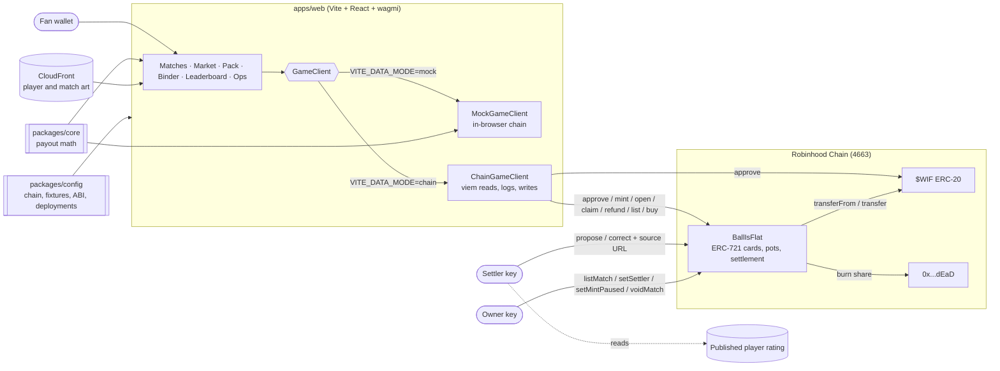
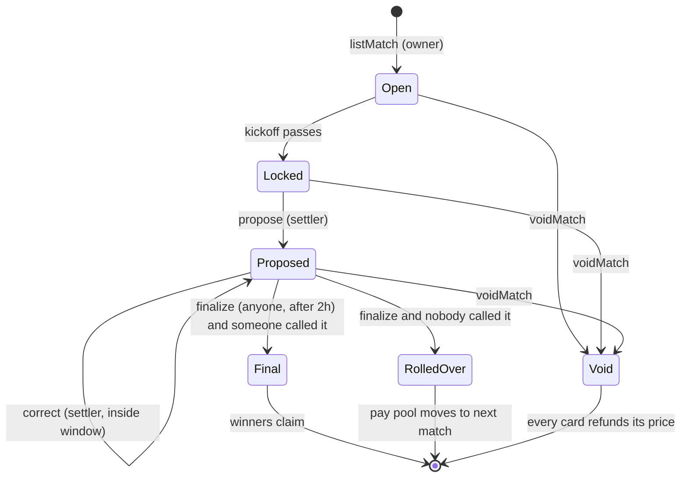

# Architecture

## System

- **One contract.** `BallIsFlat` holds every pot, mints and burns the cards, and runs settlement. It has no proxy and no external dependency beyond $WIF.
- **One client interface.** The app talks to `GameClient`. `mock` mode runs the same rules in the browser (seeded matches, a demo wallet, localStorage) so anyone can try the full flow without a wallet. `chain` mode reads the contract with viem and finds listings and history from events (`CardListed`, `CardMinted`, `MatchFinalized`), each checked against current state with `listingOf` / `cardInfo`.
- **One copy of the math.** `packages/core` computes "×N if he wins" and claim shares. The app and the tests import it, and the Foundry tests assert the same numbers on chain.
- **Config is data.** Fixtures and squads, the $WIF address, game constants, the ABI and per-network addresses live in `packages/config`. `scripts/deploy.ts` writes `deployments.json` (addresses, deploy block, fixture slug to match id).

## Match lifecycle

`stateOf(matchId)` returns exactly these states; the app shows them on every match.

| Step | Call | Effect |
|---|---|---|
| List | `listMatch` (owner) | Kickoff, price, squad player ids, per-player cap, next match for rollover |
| Pick | `mint(matchId, playerId)` | One card per minting wallet per match, before kickoff, under the player's cap. Price moves into the pot |
| Open | `open(tokenId)` | Marks the sealed pack opened (one way). Clears any listing |
| Trade | `listForSale` / `buy` / `cancelListing` | Sealed cards only, before kickoff, no escrow. 5% of the sale price is burned |
| Settle | `propose(matchId, winners[], sourceUrl)` | Starts the 2h dispute window. Several winners means a rating tie and the pot is shared |
| Correct | `correct(...)` | Settler replaces the result inside the window |
| Finalize | `finalize(matchId)` | 10% of the pot to the dead address, the rest becomes the pay pool, or rolls forward |
| Claim | `claim(tokenId)` | Burns the winning card, pays `payPool / winningCards` |
| Void | `voidMatch` (settler or owner) | Before finalize. Every card can `refund` its price; a rolled-in amount moves on |

### Rollover

On finalize with no winning card, the pay pool is added to `nextMatch` while that match is still Listed or Proposed. When there is no such match, it is burned to the dead address. Cards move between wallets only through `buy`; `transferFrom` and `safeTransferFrom` revert with `CardLocked`.

## Trust model

| Power | Holder | What limits it |
|---|---|---|
| Take $WIF out of a pot | Nobody | Funds leave only by claim, refund, the burn, or rollover |
| List matches, pause new mints, swap settler | Owner | Pausing blocks `mint` only; claim and refund can never be paused |
| Post and correct the result | Settler | Window of 2h, source URL stored on chain, anyone can read it before finalize |
| Void a match | Settler or owner | Only before finalize; refunds are full price |
| Finalize | Anyone | Only after the window |
| Upgrade or sweep | Nobody | No proxy, no sweep function. Claim rounding dust (under one wei per winning card) stays in the contract |

**Open assumption:** one settler key reports the top-rated player. The source URL and the dispute window make a wrong result visible and correctable. A decentralised reporter (several sources, or a TEE-attested verifier) is the upgrade path after the event.

## Code map

| Path | Holds |
|---|---|
| `packages/contracts/src/BallIsFlat.sol` | The game contract |
| `packages/contracts/src/IBallIsFlat.sol` | States, structs, events, errors |
| `packages/contracts/test` | Foundry tests: lifecycle, rollover, void, market, reentrancy mocks |
| `packages/core/src/payout.ts` | Multiples and claim shares |
| `packages/config/src` | Chain, constants, fixtures, ABI, deployments, art manifests |
| `apps/web/src/lib/game` | `GameClient`, mock and chain clients, queries |
| `apps/web/src/features` | One folder per screen |
| `scripts/deploy.ts` | Deploys, lists fixtures latest-first so each rolls into the next, seeds local demo state |
| `scripts/gen-art.ts` | Player and match art pipeline |
